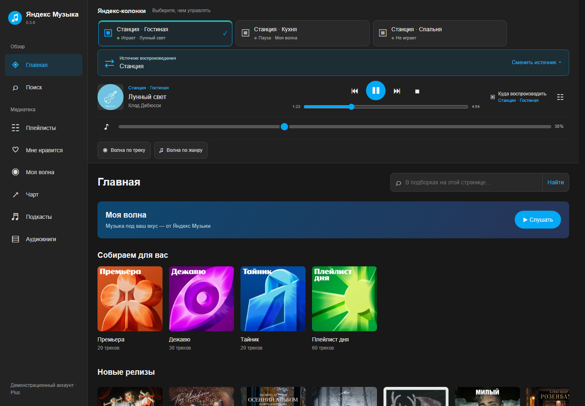
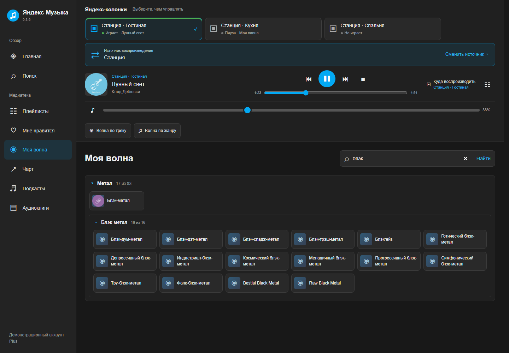
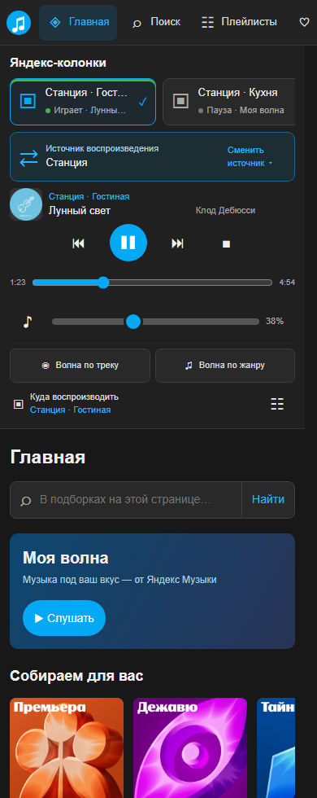
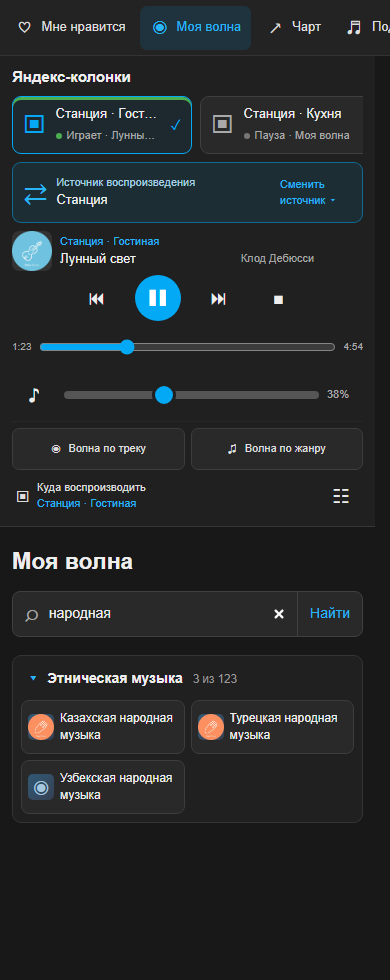

# ЯМ-ХАОС

**Яндекс Музыка в Home Assistant: медиатека, «Моя волна» и управление Станциями на одной странице.**

[](https://github.com/Lepi4/Ya-music-HA/releases/latest)
[](https://github.com/Lepi4/Ya-music-HA/actions/workflows/check.yml)
[](#установка-через-hacs)
[](LICENSE.md)

[Установка](#установка-через-hacs) · [Скриншоты](#скриншоты) · [Управление колонками](#управление-колонками) · [Обновления](CHANGELOG.md) · [GitHub](https://github.com/Lepi4/Ya-music-HA) · [GitVerse](https://gitverse.ru/Lepi4/Ya-music-HA)



Интеграция добавляет **«Яндекс Музыку» в боковое меню Home Assistant** и получает
музыкальный токен из уже настроенной интеграции Yandex Station. Music Assistant
и отдельные YAML-пакеты для работы панели не требуются.

Проект развивается. Проверен на **Home Assistant 2026.11.0**.

## Возможности

| Раздел | Что доступно |
| --- | --- |
| **Медиатека** | Плейлисты, «Мне нравится», чарты, подкасты, аудиокниги и глобальный поиск. |
| **Главная** | Подборки, названия и обложки из API Яндекс Музыки. Состав зависит от выдачи сервиса. |
| **Плеер** | Текущий трек, пауза, продолжение, стоп, следующий и предыдущий трек, перемотка и громкость выбранной колонки. |
| **Колонки и источники** | Выбор Станции одним тапом, отдельный выбор получателей и переключение `source`, включая настроенный Shield. |
| **Моя волна** | Поток с очередью на стороне HA, настроение, волна по текущему треку и по его жанру. |
| **Каталог волн** | Жанры и вложенные поджанры, этническая музыка, занятия, эпохи и другие категории из API. Поиск внутри каталога. |
| **Телефон** | Крупные элементы управления, длинный ползунок громкости и читаемые подписи кнопок волн. |

Музыку воспроизводят Яндекс-колонки из потока Яндекса. Токен остаётся на стороне
Home Assistant и не передаётся панели в браузере.

## Скриншоты

**Поиск жанров «Моей волны» с раскрытием подходящих поджанров:**



| Мобильный плеер | Поиск этнической музыки |
| --- | --- |
|  |  |

На скриншотах показана панель 0.3.6 с подборками и каталогом из API.
Аккаунт, названия колонок и состояние воспроизведения — демонстрационные.
[Порядок категорий в конце каталога](docs/screenshots/wave-categories-desktop.png).

## Установка через HACS

Перед установкой настройте [AlexxIT/YandexStation](https://github.com/AlexxIT/YandexStation)
и убедитесь, что Яндекс-колонка доступна в Home Assistant.

1. Откройте **HACS → меню → Пользовательские репозитории**.
2. Добавьте `https://github.com/Lepi4/Ya-music-HA`, категория **Интеграция**.
3. Найдите **ЯМ-ХАОС**, скачайте и перезапустите Home Assistant.
4. Откройте **Настройки → Устройства и службы → Добавить интеграцию → ЯМ-ХАОС**.
5. Выберите Яндекс-колонку, из которой нужно получить музыкальный токен.
6. Откройте **Яндекс Музыку** в боковом меню.

После обновления интеграции полностью обновите вкладку HA (**Ctrl+F5** на компьютере)
или заново откройте страницу в приложении. Переход между разделами не заменяет
уже загруженный код панели.

HACS устанавливает релизы из GitHub. GitVerse содержит те же исходники, теги
и архивы для установки через терминал.

### Через терминал Home Assistant

В Advanced SSH & Web Terminal:

```sh
curl -fL https://raw.githubusercontent.com/Lepi4/Ya-music-HA/main/scripts/install.py -o /tmp/install-ym.py
python3 /tmp/install-ym.py --config /config --version v0.3.6
ha core restart
```

Установщик сохраняет прежнюю интеграцию в `/config/backup/yandex_music_chaos/`.
Конфигурация HA, токены и остальные интеграции сохраняются. Если каталог
конфигурации отличается от `/config`, укажите его в `--config`.

### Из GitVerse

Если GitHub недоступен, получите установщик и архив через Git:

```sh
YM_SRC=$(mktemp -d)
git clone --depth 1 --branch v0.3.6 https://gitverse.ru/Lepi4/Ya-music-HA.git "$YM_SRC"
python3 "$YM_SRC/scripts/install.py" --config /config --archive-url "file://$YM_SRC/release/0.3.6/yandex_music_chaos.zip"
ha core restart
```

Архив и контрольная сумма находятся в [`release/0.3.6/`](release/0.3.6/).
При ручной установке скопируйте `custom_components/yandex_music_chaos` в
`config/custom_components/`, перезапустите HA и добавьте интеграцию через настройки.

## Управление колонками

**Выбор сверху** меняет колонку, состоянием которой управляет плеер. Достаточно
одного клика или тапа. Другие играющие колонки продолжают воспроизведение.

**«Источник воспроизведения»** переключает `source` выбранной Станции. Список
поступает из её `source_list`; например, там может быть `media_player.shield`.

**«Куда воспроизводить»** задаёт одну или несколько Яндекс-колонок для следующего
запуска музыки. **«Отправить текущий трек»** начинает этот трек на выбранных
колонках с начала. Синхронная мультирум-группа при этом не создаётся.

Для нативного запуска треков требуется рабочее локальное подключение Yandex Station.
Обычная очередь плейлиста хранится во вкладке; очередь волны — в Home Assistant.

## Моя волна

- **«Слушать»** запускает волну на выбранной Станции. Очередь ведёт Home Assistant.
- **«Волна по треку»** и **«Волна по жанру»** находятся под громкостью и используют текущую композицию.
- **Настроение** выбирается из ответа API. Изменение сохраняется в музыкальном аккаунте и может влиять на волну на других устройствах.
- **Жанры** собраны в цельные категории. Большие ветки раскрываются по смысловым группам поджанров.
- **«Этническая музыка»** объединяет национальные и региональные направления без ограничения их числа.
- **Поиск** находит жанры, поджанры и тематические волны, раскрывает совпадения и учитывает «е/ё».

«Региональные», «Темп», «Миксы» и «Исполнители» находятся в конце каталога.
«Спортивная музыка» расположена в «Темпе», «Узбекская народная музыка» — в «Этнической музыке».
Отдельного «Фрагмента рекомендаций» нет.

## Документация и разработка

- [Устройство интерфейса и связь с Music Assistant](docs/interface.md)
- [Возможности API и поддержанные типы контента](docs/api-capabilities.md)
- [Частые вопросы и диагностика](docs/troubleshooting.md)
- [Проверки, сборка и подготовка скриншотов](CONTRIBUTING.md)
- [История изменений](CHANGELOG.md) · [Релизы](https://github.com/Lepi4/Ya-music-HA/releases)

Автоматические проверки охватывают backend, интерфейс, мобильные размеры,
поиск, переключение выбранной колонки и адресатов команд. Команды воспроизведения
в браузерных тестах подменяются; проверка реального звука выполняется на устройствах.

## Лицензия

Оригинальный код — **PolyForm Noncommercial 1.0.0**:
[лицензия](LICENSE.md), [границы её действия](LICENSE-SCOPE.md).
Зависимости, музыка, обложки и товарные знаки сохраняют условия правообладателей.
Это независимый проект, не официальный продукт Яндекса.
